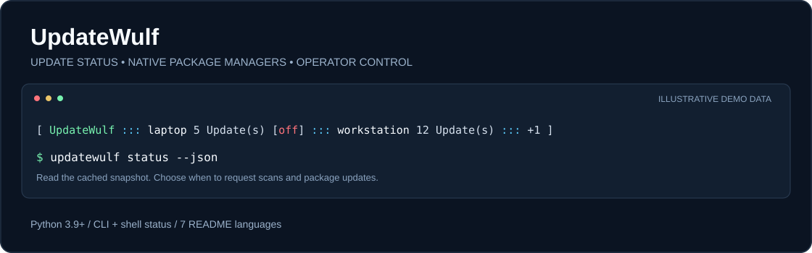

<div align="center">

# UpdateWulf

### Vos mises à jour. Vos systèmes. Votre décision.

**Consultez les mises à jour disponibles sur vos ordinateurs. Lancez les mises à jour natives des paquets quand vous le décidez.**

[Télécharger](#download) · [Premiers pas](#quick-start) · [Installer](#installation) · [Manuel](docs/manual.md) · [Dépannage](docs/troubleshooting.md)

[English](Readme.md) · [Deutsch](Readme.de.md) · **Français** · [Русский](Readme.ru.md) · [Español](Readme.es.md) · [Polski](Readme.pl.md) · [Português](Readme.pt.md)

</div>



---

| Une vue d'ensemble | Un contrôle explicite | Une mise à jour distincte de l'application |
| :--- | :--- | :--- |
| L'état mis en cache des ordinateurs inscrits, y compris les données anciennes et les appareils hors ligne. | Une requête authentifiée lance le gestionnaire natif de mises à jour de la machine cible. | UpdateWulf met à jour ses propres fichiers depuis son dépôt GitHub public. |

<a id="at-a-glance"></a>

## En bref

UpdateWulf est un service Python et un outil en ligne de commande destiné à un petit parc d'ordinateurs de confiance. Un hub HTTPS reçoit les rapports de mises à jour ; chaque ordinateur inscrit exécute un processus de travail. L'intégration au shell affiche les résultats mis en cache sans contacter le réseau à chaque invite de commande.

Le code public indique actuellement la **version 2.1.0**. Il comprend des adaptateurs pour **APT, pacman, NetBSD pkgin et Windows Update Agent**. La couverture des adaptateurs et des tests natifs varie selon la plateforme ; consultez les [prérequis](#requirements) et le [compte rendu de vérification](docs/documentation-status.md). Les sept traductions du README ne signifient **pas** que l'interface du programme est entièrement traduite en sept langues : certains messages restent en allemand.

### Cas d'utilisation

- Un laboratoire personnel ou un petit parc dont vous souhaitez consulter les mises à jour dans un seul terminal.
- Des machines Linux, Windows et NetBSD utilisant leurs gestionnaires de paquets natifs.
- Des sessions SSH où une ligne d'état compacte est plus utile qu'un tableau de bord.
- Des opérateurs souhaitant choisir quand installer les mises à jour tout en conservant les mécanismes de droits du système d'exploitation.

UpdateWulf n'est ni un système de sauvegarde ni une plateforme générale de déploiement de logiciels. Il ne prend pas en charge winget, Flatpak, Snap, Homebrew ni la gestion automatique des redémarrages. La synchronisation de dépôts subsiste pour la compatibilité avec les anciennes installations ; les nouvelles fonctions de synchronisation Git relèvent de GitSyncWulf.

<a id="quick-start"></a>

## Premiers pas

**Pour découvrir le programme :** utilisez Python 3.9+ et Git pour le clonage ci-dessous, ou téléchargez et extrayez d'abord l'archive ZIP du code source. Aucun service ni aucune configuration ne sont nécessaires.

```sh
git clone https://github.com/n-e-o-w-u-l-f/UpdateWulf.git
cd UpdateWulf
python3 pc_mesh.py --version
python3 pc_mesh.py --help
```

Sous Windows, utilisez `py -3` à la place de `python3` si c'est votre lanceur Python.

**Déjà installé et inscrit ?** Ouvrez un nouveau terminal :

```sh
updatewulf status
updatewulf status --json
updatewulf diagnose
updatewulf --self update --check
```

`status` lit un instantané local. `diagnose` vérifie le hub HTTPS configuré. `--self update --check` consulte la branche publique de l'application sans l'installer. Un instantané vide ne prouve pas que tous les ordinateurs sont à jour.

<a id="requirements"></a>

## Prérequis

| Plateforme | Environnement d'exécution et adaptateur natif | Méthode d'installation | Limites actuelles |
| :--- | :--- | :--- | :--- |
| Debian / Raspberry Pi OS | Python 3.9+, `apt-get` | Service utilisateur ; service système systemd | Les nouvelles analyses utilisent un cache de métadonnées distinct. |
| Arch Linux | Python 3.9+, `pacman`, `vercmp` | Service utilisateur ; service système systemd | Les métadonnées des dépôts et les mises à jour des paquets nécessitent un accès réseau. |
| Windows | Python 3.9+ avec un véritable `python.exe` ; Windows PowerShell et Windows Update Agent | Tâche planifiée utilisateur ; tâches système avec privilèges élevés | Aucun adaptateur winget ; les tests natifs Windows n'ont pas été exécutés pendant cette session de documentation. |
| NetBSD | Python 3.9+, `pkgin` | Solution de repli par cron utilisateur ; service natif `rc.d` | Les analyses sans droits root peuvent utiliser les métadonnées pkgin en cache. |
| Android / Termux | Python 3.9+, APT, compte Termux réel | Script de démarrage Termux | Termux:Boot est nécessaire au démarrage après un redémarrage ; ne met pas à jour le système Android. |
| Autres plateformes | La CLI peut fonctionner avec Python | Aucune procédure d'installation native complète | Les collecteurs non pris en charge indiquent `UNSUPPORTED`, pas zéro mise à jour. |

Tous les processus de travail connectés au réseau nécessitent une configuration inscrite, un hub HTTPS, son certificat de confiance, un jeton de membre unique et un espace d'état accessible en écriture. **Git est nécessaire à la mise à jour de l'application elle-même.** L'installation utilisateur Unix nécessite un gestionnaire systemd utilisateur fonctionnel ou `crontab` ; `scripts/install.sh` nécessite Bash. Les anciens utilitaires facultatifs d'inscription utilisent Paramiko ; le service principal utilise la bibliothèque standard de Python.

<a id="download"></a>

## Télécharger

- [Télécharger le ZIP du code source actuel](https://github.com/n-e-o-w-u-l-f/UpdateWulf/archive/refs/heads/main.zip).
- [Parcourir le code source](https://github.com/n-e-o-w-u-l-f/UpdateWulf).
- [Consulter les versions publiées](https://github.com/n-e-o-w-u-l-f/UpdateWulf/releases).

Au point de référence de cette documentation, aucun fichier de version étiquetée ni installateur MSI, EXE, DEB ou PKG n'était publié. Le ZIP suit la branche évolutive `main`. Pour une installation reproductible depuis un clone, notez le commit téléchargé avec `git rev-parse HEAD`. Le ZIP n'est pas un installateur natif signé.

<a id="installation"></a>

## Installation

### Choisir la portée

| Vous avez besoin… | Choisissez… | Ce qui change |
| :--- | :--- | :--- |
| De commandes et d'une ligne d'état du shell pour votre compte | Installation utilisateur | Vos lanceurs, les blocs gérés dans les profils du shell et, éventuellement, un processus de travail utilisateur. |
| D'un processus qui démarre avec l'ordinateur et peut exécuter les mises à jour autorisées du système | Service système | Un service ou une tâche natifs, un utilitaire protégé de mise à jour des paquets et une configuration explicite du propriétaire. |
| De découvrir l'outil | Copie du code source | Exécutez `pc_mesh.py --help` / `--version` ; aucune installation n'est nécessaire. |

**Configurez d'abord l'inscription :** suivez la [configuration du hub et des membres](docs/configuration.md#first-setup). Les fichiers dans [examples/](examples/) contiennent des valeurs à remplacer, pas des identifiants utilisables. Conservez votre configuration complétée en dehors de l'arborescence du code, normalement dans `~/.config/pc-mesh/config.json` (`%USERPROFILE%\.config\pc-mesh\config.json` sous Windows). Gardez le répertoire téléchargé du programme à un emplacement permanent : les installateurs y font référence.

### Installer pour votre utilisateur

Depuis le répertoire du code téléchargé, utilisez le compte qui exécutera UpdateWulf :

```sh
# Unix : installer les scripts de lancement, l'intégration au shell et un processus de travail utilisateur persistant.
python3 install.py
```

```powershell
# Windows PowerShell : utiliser le véritable exécutable Python, pas un alias du Microsoft Store.
$Python = (Get-Command python.exe -ErrorAction Stop).Source
& $Python -c "import sys; assert sys.version_info >= (3, 9)"
.\install_windows.ps1 -Python $Python
```

Pour installer uniquement l'intégration au shell, utilisez `python3 install.py --prompt-only` ou `.\install_windows.ps1 -Python $Python -PromptOnly`. Cette option ne collecte pas de nouvel état : elle nécessite le cache d'un processus de travail existant. Sous Termux, exécutez `python install_termux.py` dans la session Termux réelle. La mise à jour de l'application sous Termux nécessite actuellement un remplacement manuel adapté à cette plateforme ; conservez `auto_self_update: false`, car le mécanisme général ne met pas à jour son script de démarrage.

Ouvrez un nouveau terminal et exécutez `updatewulf --version`, `updatewulf diagnose` et `updatewulf status`. Le [guide d'installation](docs/installation.md) explique les chemins, le démarrage, la vérification et le retour à la version précédente.

### Installer pour tout le système

L'installation système fournit un processus de travail natif et des droits contrôlés de mise à jour des paquets ; elle ne configure pas automatiquement le shell de chaque utilisateur. Préparez d'abord un compte de service dédié et sa configuration inscrite. Utilisez un emplacement permanent du code contrôlé par un administrateur et suivez la procédure de bascule propre à la plateforme :

- [Linux / systemd](docs/installation.md#linux-systemwide) : `enable_machine_updates.py --user … --config … --state … --source …`, depuis une véritable session root.
- [Windows](docs/installation.md#windows-systemwide) : `enable_machine_updates_windows.ps1 -Python … -Config … -Owner …`, depuis une console du propriétaire avec privilèges élevés.
- [NetBSD](docs/installation.md#netbsd-systemwide) : `enable_machine_updates_netbsd.py --config … --state … --python …`, depuis une véritable session root.

Ces installateurs n'élèvent pas leurs propres privilèges. Une installation gérée par un service système utilise sa procédure native de bascule de version, pas l'installateur de mise à jour utilisateur.

<a id="everyday-examples"></a>

## Exemples courants

Remplacez `workstation.local` par un nom d'hôte signalé ou inscrit, ou utilisez l'identifiant exact du membre. Les syntaxes commençant par l'hôte et par l'action sont toutes deux acceptées.

| Objectif | Commande | Effet |
| :--- | :--- | :--- |
| Lire l'état du parc en cache | `updatewulf status` | Lecture locale. |
| Consulter un ordinateur | `updatewulf workstation.local status` | Instantané local filtré. |
| Exporter l'état | `updatewulf status --json` | Instantané brut, horodatages inclus. |
| Désactiver les couleurs de la CLI | `updatewulf status --no-color` | Texte sans couleurs. |
| Diagnostiquer la connexion | `updatewulf diagnose` | `GET /fleet` authentifié ; aucun travail de mise à jour. |
| Demander une nouvelle analyse | `updatewulf workstation.local refresh --wait 60` | Met une analyse en file d'attente et attend jusqu'à 60 secondes. |
| Installer les mises à jour des paquets du système | `updatewulf workstation.local update --wait 600` | Demande explicite de mise à jour native ; nécessite l'inscription et les droits sur la cible. |
| Mettre en file sans attendre | `updatewulf workstation.local update --wait 0` | Affiche la tâche en attente ; ne prouve pas son achèvement. |
| Ouvrir le menu | `updatewulf tui` | Menu interactif de l'opérateur ; voir le problème connu du parc vide. |
| Vérifier UpdateWulf lui-même | `updatewulf --self update --check` | Consulte la branche publique de l'application. |
| Mettre à jour UpdateWulf lui-même | `updatewulf --self update` | Prépare, vérifie et active le code de l'application pour une installation utilisateur prise en charge. |

`updatewulf all update` demande des mises à jour pour **toutes les cibles inscrites**. Utilisez cette commande uniquement si telle est la portée voulue. L'expiration du délai d'attente de la CLI n'annule pas un gestionnaire de paquets déjà lancé. La référence complète des actions, des options et des codes de retour figure dans le [manuel](docs/manual.md).

<a id="configuration"></a>

## Configuration

La configuration est au format JSON. Commencez par un exemple de [client](examples/config.client.json), de [hub](examples/config.hub.json) ou d'[opérateur](examples/control.json), puis suivez la [référence complète de configuration](docs/configuration.md). Les chemins JSON sont littéraux : utilisez des chemins absolus ; `~` et les variables d'environnement ne sont généralement pas développés dans les chaînes JSON.

| Paramètre | Valeur par défaut dans le code | Signification |
| :--- | :--- | :--- |
| `scan_interval` | `1800` secondes | Intervalle entre les analyses de paquets. |
| `report_interval` | `20` secondes | Intervalle entre les rapports au hub. |
| `auto_self_update` | `true` | Active la mise à jour de l'application lorsque le mode du processus de travail le permet. |
| `self_update_interval` | `21600` secondes | Intervalle de vérification de l'application ; limité à 1–24 heures, après une attente initiale de 5 minutes. |
| `self_update_branch` | `main` | Branche publique de l'application. |
| `announce_only` | `false` | Désactive l'ancien traitement Git ; avec `machine_control: false`, désactive également le traitement des requêtes. |
| `machine_control` | `false` | Active les demandes d'analyse et d'installation en mode annonce seule. |
| `native_installer` | `false` | Transmet les installations à un utilitaire natif préalablement configuré. |

Les exemples définissent volontairement `auto_self_update: false` afin de rendre la première configuration prévisible. Activez cette fonction après avoir vérifié une installation utilisateur publique. Pour les commandes de l'opérateur, `control.json` à l'emplacement par défaut a priorité sur `config.json` ; un `--config` explicite avec un autre chemin sélectionne ce fichier. Les chemins personnalisés de configuration et d'état présentent des limites lors de la mise à jour de l'application, décrites dans les [problèmes connus](docs/troubleshooting.md#known-issues).

<a id="services-status-and-self-update"></a>

## Services, état et mise à jour de l'application

Le service utilisateur s'appelle `updatewulf.service` sous systemd ou `UpdateWulf-User` dans le Planificateur de tâches Windows. Les noms des services système diffèrent ; le [guide d'installation](docs/installation.md) les répertorie. Les journaux et instantanés sont normalement stockés dans `~/.local/state/pc-mesh/`, notamment `service.log`, `heartbeat.json`, `fleet.json` et `executed-commands.json`.

L'état peut être `OK`, `CACHED`, `CHECKING`, `UNKNOWN`, `ERROR` ou `UNSUPPORTED`. Les données en cache et celles des appareils hors ligne restent visibles sans être présentées comme une nouvelle analyse réussie. Les tâches ont leurs propres états, notamment `QUEUED`, `RUNNING`, `SUCCEEDED`, `FAILED`, `NEEDS_ADMIN`, `EXPIRED` et `INTERRUPTED`.

La mise à jour de l'application vérifie l'identité du dépôt, l'intégrité et l'ascendance des objets Git, exécute les vérifications sur la version préparée et conserve la version actuelle ainsi que la précédente. La vérification Git n'est pas un mécanisme de signature des versions. La première migration nécessite une commande explicite de l'opérateur. La configuration existante et les données d'inscription restent en dehors du répertoire de version. Le retour à une version précédente et les limites prudentes du nettoyage sont expliqués dans le [manuel](docs/manual.md#application-self-update).

<a id="known-issues-and-troubleshooting"></a>

## Problèmes connus et dépannage

Le [guide de dépannage](docs/troubleshooting.md#known-issues) décrit les limites concrètes et leurs solutions de contournement. Actuellement :

- Aucun désinstallateur multiplateforme complet ; suivez la [procédure de suppression manuelle](docs/installation.md#uninstall).
- La mise à jour utilisateur ne conserve pas de manière fiable les chemins personnalisés d'état et de configuration sous Unix ; utilisez les chemins par défaut ou une bascule native manuelle.
- La TUI peut échouer lors de la navigation dans un parc vide ; utilisez `status` et `diagnose` jusqu'à l'inscription d'un membre.
- L'intégration de l'invite Bash ne respecte pas entièrement `NO_COLOR` ; utilisez `status --no-color` pour garantir une sortie CLI sans couleurs.
- Le contenu inconnu d'une version, y compris des répertoires de documentation supplémentaires, empêche par précaution le nettoyage automatique.
- Les adaptateurs macOS/Homebrew, winget, Flatpak et Snap ainsi que la traduction complète du programme ne sont pas implémentés.

Si une commande est introuvable, ouvrez un nouveau shell et vérifiez le répertoire des exécutables de votre utilisateur. Pour `NEEDS_ADMIN`, vérifiez l'utilitaire natif et l'autorisation `allow_install` du membre. Pour les erreurs TLS ou d'authentification, vérifiez le certificat, le nom d'hôte et l'inscription. Ne considérez pas qu'une vérification en échec signifie qu'il n'y a aucune mise à jour.

<a id="manual-and-project-information"></a>

## Manuel et informations du projet

| Documentation | Contenu |
| :--- | :--- |
| [Installation](docs/installation.md) | Configuration utilisateur/système, services, vérification, retour à la version précédente et désinstallation. |
| [Manuel](docs/manual.md) | Toutes les actions et options de la CLI, exemples, états, journaux et mise à jour de l'application. |
| [Configuration](docs/configuration.md) | Configuration du hub, des membres et des opérateurs, clés, valeurs par défaut, chemins et priorités. |
| [Dépannage](docs/troubleshooting.md) | Symptômes, bogues connus, solutions pratiques et FAQ. |
| [Vérification](docs/documentation-status.md) | Ce qui a été vérifié et ce qui nécessite encore un test natif sur la plateforme. |
| [Modèle README](docs/README_TEMPLATE.md) | Structure de présentation réutilisable pour les projets en sept langues. |
| [Recherche de conception](docs/readme-design-research.md) | Dix README de référence issus de sources primaires et les choix de présentation retenus. |

Le manuel technique détaillé est actuellement maintenu en anglais ; chacun des sept README fournit les mêmes premiers pas et la même vue d'ensemble du fonctionnement dans sa langue.

**Contribuer / obtenir de l'aide :** [ouvrez une issue](https://github.com/n-e-o-w-u-l-f/UpdateWulf/issues) en indiquant le système d'exploitation, la version de Python, le commit UpdateWulf, la commande exacte et une sortie expurgée des informations sensibles. Ne joignez jamais de jetons, de clés privées ni de fichiers de configuration réels. Consultez les [vérifications pour contribuer](docs/manual.md#contributing).

**Licence :** le dépôt ne contient actuellement aucun fichier de licence. Cette documentation ne choisit ni n'accorde de licence ; demandez au responsable du projet quelles réutilisations sont autorisées.

---

<div align="center">

[Retour en haut](#updatewulf) · [Télécharger le code source](https://github.com/n-e-o-w-u-l-f/UpdateWulf/archive/refs/heads/main.zip) · [Lire le manuel](docs/manual.md)

</div>
